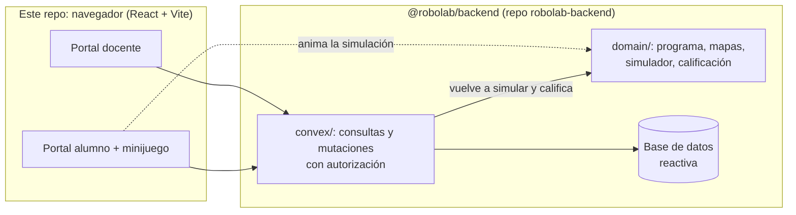

# RoboLab

Retos de programación con un robot, para Inicial y Primaria, en dos modos:

- **Explorar retos (sin cuenta).** Cualquiera entra, elige un tópico y un
  nivel y resuelve retos de pensamiento computacional: armar la secuencia,
  esquivar obstáculos, predecir dónde termina el robot, corregir un programa
  con error, pasar por paradas y resolver con pocos bloques. Wayra, la guía,
  reacciona a cada intento y da hasta 3 pistas. El avance se guarda en el
  dispositivo.
- **Clases.** Cada clase tiene un código (como `TEC-482`): el alumno se une con
  ese código y un apodo, sin cuenta. El docente asigna retos a la clase y ve
  quién los logró; también arma evaluaciones (preguntas, alternativas,
  respuesta correcta y puntaje) donde cada vez que el alumno llega a una
  estrella se desbloquea una pregunta. El docente ve los resultados en vivo, un
  ranking y el desarrollo del aprendizaje.

Como extra, el mismo programa se puede enviar a un robot físico (ESP32) por
wifi con el botón "Enviar al robot". El relé, el protocolo y el firmware están
en el repo del backend:
[robolab-backend/docs/robot-wifi.md](https://github.com/orinqq/robolab-backend/blob/main/docs/robot-wifi.md).

Hecho para el track **Educación Escolar** de Hack the Andes 2026.

Este repo es la **web** (Vite + React 19 + TypeScript). El backend en Convex y
el dominio compartido (reglas del juego, calificación, códigos) viven en
[orinqq/robolab-backend](https://github.com/orinqq/robolab-backend) y llegan
aquí como el paquete npm `@robolab/backend`.

## Qué hace

**Explorar retos**

- Portada con los cinco tópicos STEAM; Tecnología ya tiene 11 retos (5 de
  Inicial y 6 de Primaria) y los demás se muestran como "Próximamente".
- Cada reto tiene una ficha (historia, tiempo, habilidad, vista previa del
  tablero), el juego con Wayra y sus pistas, y "¡Reto logrado!" con intentos,
  pistas y tiempo.
- "Mi avance" muestra lo resuelto por tópico en ese dispositivo.
- Cada partida resuelta se registra de forma anónima (un identificador al azar
  del dispositivo, sin nombres) para medir el uso real; el servidor vuelve a
  revisar si el reto se resolvió.

**Docente**

- Se registra e inicia sesión con correo y contraseña. La contraseña pide
  minúscula, mayúscula, número, símbolo y 8 caracteres, y el formulario marca
  cada regla mientras se escribe.
- Si la olvida, recibe un código de 6 dígitos en su correo registrado (vence
  en 15 minutos).
- Crea clases (nivel, grado y sección): cada una recibe un código para copiar y
  compartir; los alumnos se unen solos con su apodo. Puede eliminar una clase
  con todo lo que cuelga de ella.
- Crea retos: tópico y nivel, un juego ya hecho (bloques en Inicial, misiones en
  Primaria) y quién lo verá (público, solo su clase o borrador). Obtiene un
  enlace para compartir y lo asigna a una clase.
- Ve los retos de cada clase con el porcentaje que lo logró y, por reto, la
  tabla por apodo (intentos, pistas y tiempo) con lo que se observó. Solo se
  muestra lo observable; no se diagnostica.
- Crea evaluaciones: título, clase, fecha y de 1 a 10 preguntas con 2 a 4
  alternativas, respuesta correcta y puntaje.
- Ve los resultados en vivo, un ranking que solo ve el docente y el desarrollo
  del aprendizaje con cuatro medidas (logro, intentos por estrella, tiempo y
  veces que la rindió), con gráfica y tabla de detalle.

**Alumno**

- Se une a su clase con el código de la clase y un apodo, sin cuenta ni
  contraseña, y ve su evaluación del día y los retos de su clase. En "Mi avance"
  aparece su apodo y su clase.
- Arma un programa tocando bloques (avanzar, retroceder y girar; en Primaria
  también repetir) y lo ejecuta. Si el robot se sale del camino, se le
  dice en qué paso y se marca ese bloque.
- Al llegar a la estrella aparece la pregunta, que también se lee en voz alta.
- Al final ve su puntaje, el tiempo y cuántas veces ejecutó el robot. Puede
  intentarlo de nuevo.

## Arquitectura

### Programar con gestos en Inicial

En los retos abiertos de Inicial que permiten editar el programa aparece el modo
**Gestos**. Elige **Activar cámara**, permite el acceso y muestra una sola mano:

| Gesto | Acción |
| --- | --- |
| ☝️ Índice apuntando arriba | Avanzar |
| 👇 Índice apuntando abajo | Retroceder |
| 👈 Índice apuntando a la izquierda | Girar a la izquierda |
| 👉 Índice apuntando a la derecha | Girar a la derecha |
| 👍 Pulgar arriba | Confirmar y ejecutar el programa visible |

Mantén el gesto hasta llenar la barra (0,8 segundos para bloques; 1,2 para
confirmar). Retira la mano durante al menos 0,4 segundos entre gestos, también
para repetir el mismo bloque. Puedes quitar un bloque tocándolo, borrar el
programa o cambiar a **Botones** sin perder la secuencia. Un programa vacío no
se ejecuta y la entrada queda en pausa mientras Kusi se mueve.

Usa el índice extendido con los otros dedos recogidos. Las cuatro direcciones
se calculan con los puntos de la mano de MediaPipe y coinciden con la vista en
espejo; no dependen de los gestos «Victoria» o «Te quiero». Una dirección
diagonal o un dedo apuntando hacia la cámara no agrega bloques. Las órdenes
siguen siendo relativas al robot: arriba agrega Avanzar, abajo Retroceder y
los lados agregan un giro, cualquiera sea la orientación actual de Kusi.

Retroceder en Inicial requiere el cambio compartido del
[PR del backend #6](https://github.com/orinqq/robolab-backend/pull/6).
El paquete queda fijado al commit de ese PR para probarlo. Antes de usarlo en
producción, hay que fusionar y desplegar ese cambio del backend.

La cámara se activa solo al pedirla; se apaga al salir del reto, cambiar a
Botones, ocultar la pestaña o fallar la captura. No se pide micrófono, no se
graba vídeo y las imágenes se procesan en el equipo con MediaPipe en un worker.
El modelo y WebAssembly se descargan de Google y jsDelivr al activar la cámara;
se necesita internet para esa carga. Las versiones están fijadas. HTTPS (o
localhost) es obligatorio. Si se deniega el permiso o falla el modelo, sigue
disponible el modo Botones.

**Para probar:** abre `/reto/inicial-paseo`, empieza el reto y arma una secuencia
con la cámara. Revisa los bloques y confirma con 👍 o con el botón de confirmación.
Prueba también `/reto/inicial-gira` para los giros. Los retos de predicción,
Primaria y las evaluaciones de clase mantienen su entrada habitual.

El enlace publicado `/r/cie-inicial/` pertenece a otra versión de la web:
su reto «El tubo de ensayo» no está en el catálogo `@robolab/backend` de este
repositorio. Esta implementación usa los retos actuales de Inicial; no crea
mapas ni reglas de juego en la web.

### Flujo compartido



- **Dominio compartido por npm.** Las reglas del juego y de la calificación se
  importan de `@robolab/backend/domain/...`: el navegador las usa para animar al
  robot y el servidor para validar. Es el mismo código, instalado desde git.
- **Funciones tipadas.** `@robolab/backend/convex/_generated/api` y
  `.../dataModel` dan los tipos de las funciones y de los `Id<"tabla">`;
  TypeScript revisa que cada llamada mande los argumentos correctos.
- **El servidor manda.** La web muestra; el backend vuelve a simular, cuenta las
  ejecuciones y califica con su reloj. La respuesta correcta nunca llega al alumno.

### Carpetas

```
src/features/      pantallas: explore/, teacher/, student/, game/, robot/, landing/
src/shared/        estilos, errores, conexión y componentes comunes
src/app/           rutas
public/            gráficos del robot, bloques y estrella
```

## Cómo correrlo

Requisitos: **Node 22.12 o superior** (hay un `.nvmrc`) y git.

**1. Backend primero.** Clonar [robolab-backend](https://github.com/orinqq/robolab-backend)
y seguir su README (`npm ci`, `npx convex dev`, `npm run setup`). Al terminar,
su `.env.local` tiene un `CONVEX_URL=https://....convex.cloud` (o la dirección
del backend local).

**2. Web.**

```bash
git clone https://github.com/orinqq/robolab-web.git
cd robolab-web
npm ci
```

Crear `.env.local` con la dirección del backend (ver `.env.example`):

```
VITE_CONVEX_URL=<el CONVEX_URL del .env.local del backend>
```

```bash
npm run dev
```

Abre http://localhost:5173. Sin cuenta se juegan los retos; en "Soy docente"
se crea una cuenta en ese backend.

### Actualizar el backend

`npm ci` instala `@robolab/backend` desde GitHub por https, en el **commit exacto**
que fija `package-lock.json`. Cuando el backend cambie en `main`, traer la
versión nueva y commitear el lockfile:

```bash
npm install git+https://github.com/orinqq/robolab-backend.git#main
git add package.json package-lock.json
git commit -m "Backend al día"
```

Si TypeScript marca una función o un tipo que ya no existe, el backend cambió
su contrato: ajustar la web en ese mismo cambio.

## Pruebas y calidad

```bash
npm run verify     # tipos + lint + pruebas + build
```

Las pruebas de la web (Vitest) cubren el adaptador wifi del robot, el editor
de preguntas, la gráfica de progreso y el aviso de conexión. Las del dominio y
del backend corren en el repo del backend. GitHub Actions corre `npm run verify`
en cada push y pull request. Las reglas para colaborar (personas o agentes de IA)
están en [AGENTS.md](AGENTS.md).

## Despliegue en Vercel

1. Importar este repo en Vercel con framework **Vite** (Build Command
   `npm run build`, Output Directory `dist`, los valores por defecto).
2. Variable de entorno `VITE_CONVEX_URL` con la dirección del despliegue de
   producción de Convex (`https://<despliegue>.convex.cloud`).
3. `vercel.json` ya trae las reglas de la SPA (toda ruta carga `index.html`) y
   los encabezados de seguridad.

El backend se despliega aparte (`npx convex deploy` o el flujo de GitHub del
repo del backend) y debe tener `SITE_URL` y `ROBOT_WEB_ORIGINS` con la dirección
de esta web. Para que el build de Vercel pueda instalar `@robolab/backend`, la
dependencia va con `git+https://` (no `github:` ni ssh): Vercel no tiene llaves
ssh y el repo del backend es público.

## Decisiones

- **Editor de bloques por toques**, no por arrastre: más fácil para manos de
  5 años y para pantallas táctiles.
- **Retroalimentación determinista**: el simulador dice en qué paso falló el
  robot. No se usa un modelo de IA para corregir, así que el resultado es
  explicable y no tiene costo por uso.
- **Gráfica en SVG propio**, sin librería: liviana, accesible (leyenda,
  etiquetas directas, tabla) y con colores probados para daltonismo.
- **Backend como paquete git** en vez de copiar el dominio: una regla del juego
  existe una sola vez y el lockfile dice con qué commit del backend se compiló
  cada versión de la web.

## Créditos

Los gráficos del robot y de los bloques vienen del kit Inrobit que el equipo
hizo en 2025. Wayra se dibuja con [blobatar](https://github.com/Alain00/blobatar)
(MIT), en el navegador y sin conexión a terceros. Todo el código de esta
aplicación es nuevo.
